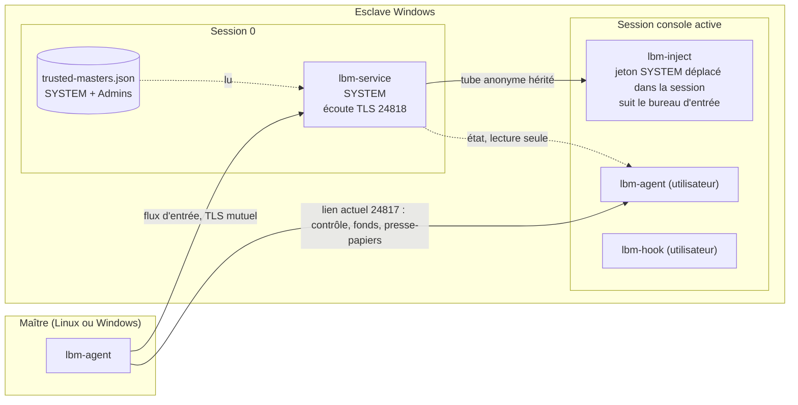

# Service Windows de l'esclave multi-PC : conception

> **Statut : proposition, à valider par le mainteneur avant tout code.** Rien de ce qui
> suit n'a tourné. Les comportements de Windows marqués *(à vérifier)* ne sont connus que
> par la documentation ou par l'usage qu'en font d'autres outils, pas par un essai ici.

Contexte : [`multi-pc-etat.md`](multi-pc-etat.md), « 3. Esclave Windows : les deux
trous ». L'esclave injecte par `SendInput` depuis `lbm-hook` (`remote/windows.rs`), un
processus de la session de l'utilisateur, au niveau d'intégrité de l'agent qui l'a lancé.
Deux cas lui échappent :

1. **Le bureau sécurisé** (`winsta0\winlogon`) : invite UAC, écran de verrouillage,
   écran Ctrl+Alt+Suppr. Seul SYSTEM peut ouvrir ce bureau, et `SendInput` n'atteint que
   le bureau d'entrée auquel le thread appelant est attaché.
2. **Les fenêtres élevées ou UIAccess** (`osk.exe`, Gestionnaire des tâches, une console
   administrateur) pour un **utilisateur standard** : UIPI jette tout, mouvement compris
   (essai vm124 du 2026-11-24). Un administrateur à jeton fractionné a déjà
   `StartElevated` ; un utilisateur standard n'a rien.

Un service SYSTEM couvre les deux. Le reste de ce document dit comment, et surtout
**comment ne pas en faire un contournement d'UAC** : l'autostart élevé en était un (PR #742
et #743), un service qui injecte au-dessus de tout en serait un bien pire.

## 1. Le point dur : qui a le droit de nourrir l'injecteur

Un processus qui injecte sur le bureau sécurisé peut cliquer « Oui » dans une invite de
consentement UAC. Quiconque peut lui dicter ses entrées peut donc :

- lancer lui-même `ShellExecute(..., "runas", payload)` puis valider l'invite : pour un
  administrateur à jeton fractionné, c'est l'admin sans consentement ;
- piloter une console administrateur déjà ouverte, ou l'écran de verrouillage.

La demande initiale proposait un **canal agent → service limité à l'utilisateur**. Ce n'est
pas suffisant, et c'est la principale correction de cette conception : l'agent tourne en
intégrité moyenne, sous le compte de l'utilisateur. N'importe quel processus de ce même
utilisateur, au même niveau, peut :

- ouvrir le même pipe (la DACL « utilisateur seulement » le laisse passer) ;
- injecter du code dans l'agent (`OpenProcess` avec tous les droits est permis entre
  processus du même utilisateur et du même niveau) ;
- réécrire `peers.json` dans `%APPDATA%` pour y ajouter son propre « maître ».

Un canal limité à l'utilisateur donne donc l'injection sur le bureau sécurisé à **tout
logiciel qui tourne sous ce compte**. C'est exactement la frontière que le bureau sécurisé
existe pour tenir.

Trois façons d'ancrer la confiance ailleurs :

| | Qui nourrit l'injecteur | Ce qu'un processus moyen de l'esclave peut faire | Coût |
|---|---|---|---|
| A | l'agent, par un pipe à DACL utilisateur | **tout** (pipe, injection dans l'agent, `peers.json`) | faible ; **rejeté** |
| B | **le service lui-même**, qui reçoit le flux d'entrée du maître par TLS mutuel, depuis un maître qu'un **administrateur** a approuvé dans un magasin protégé | rien : il n'a ni la clé du maître, ni le droit d'écrire le magasin, ni celui d'ouvrir un processus SYSTEM | une seconde connexion TLS, terminée en SYSTEM ; un changement côté maître |
| C | l'agent, relevé en intégrité haute par le service | toujours `peers.json` et la configuration, écrits par l'utilisateur ; et l'agent entier (réseau, JSON, fonds, presse-papiers) devient la surface protégée | lourd et toujours troué ; **rejeté** |

**Recommandation : B.** La racine de confiance devient « un maître approuvé par un
administrateur de l'esclave », ce qui est la définition même de la fonction : le clavier du
maître sert de clavier à l'esclave, y compris sur le bureau sécurisé.

Risque résiduel, à écrire dans l'aide et dans l'installeur : **qui contrôle la session du
maître contrôle le bureau sécurisé de l'esclave**, comme un clavier USB qu'on y aurait
branché. Un logiciel malveillant en intégrité moyenne *sur le maître* peut injecter dans
l'agent du maître et taper sur l'invite UAC de l'esclave. Deskflow et Synergy, qui font
tourner leur cœur en SYSTEM sur l'esclave, ont la même propriété. C'est la raison pour
laquelle la fonction est désactivée par défaut et soumise à un administrateur de l'esclave,
maître par maître.

### Approbation d'un maître

- Magasin : `%ProgramData%\LittleBigMouse\service\trusted-masters.json`, dossier créé par
  l'installeur avec une DACL explicite, sans héritage : SYSTEM et Administrateurs en
  contrôle total, rien d'autre (pas même la lecture pour les utilisateurs : elle n'est
  pas nécessaire). Le service **refuse de démarrer** si la DACL du dossier ou du fichier
  laisse écrire quelqu'un d'autre (même contrôle que `lbm-agent/src/admin_only.rs`, réutilisé).
- Contenu : empreintes de certificat de maître (`MachineId` de `lbm-net`) et le nom
  affiché au moment de l'approbation. Rien d'autre : pas de chemin, pas de commande.
- Écriture : seulement par `lbm-service.exe trust <empreinte>` / `untrust`, lancé élevé.
  L'interface de l'esclave propose « Autoriser <maître> sur le bureau sécurisé », qui
  relance cette commande par `runas` : une invite UAC, ou une demande d'identifiants pour
  un utilisateur standard (c'est voulu : il faut un administrateur).
- La commande élevée **affiche elle-même** le nom et l'empreinte et demande confirmation,
  au lieu de faire confiance à son argument : sinon un processus moyen qui guette le clic
  pourrait lancer la même commande avec sa propre empreinte, et l'utilisateur
  consentirait à l'invite UAC qu'il attendait. L'empreinte est celle que la page Machines
  du maître affiche déjà ; l'utilisateur les compare.
- Le service est notifié d'un changement par un code de contrôle SCM privé (128+),
  envoyé par la commande élevée ; il relit alors le magasin. Pas de surveillance du
  fichier.

## 2. Architecture

### `lbm-service` (session 0, LocalSystem)

Binaire séparé, le plus petit possible ; plomberie SCM par le crate `windows-service`
(déjà essayée dans le spike `spike/windows-service`, 127cc898).

- **Écoute** le flux d'entrée sur un port à lui (proposé : 24818), TLS 1.3 mutuel avec
  `lbm-net::tls` : la poignée de main prouve la clé du maître, le service n'accepte que
  les empreintes du magasin. Sa propre identité (certificat et clé) vit dans le même
  dossier protégé ; elle est distincte de celle de l'agent, que l'utilisateur peut lire.
  N'écoute **que si le magasin n'est pas vide**.
- Ne décode que des lots `lbm_ipc::input` (longueur bornée à `MAX_BATCH_SIZE`, puis événements binaires à étiquette), et
  les passe à l'injecteur de la session console active. Aucun JSON, aucun fichier, aucune
  commande venue du réseau ne fait autre chose qu'une entrée.
- **Lance l'injecteur** dans la session console active : jeton SYSTEM du service,
  `DuplicateTokenEx` + `SetTokenInformation(TokenSessionId)` (variante c du spike),
  `CreateProcessAsUser` sur `winsta0\default`. Le lien est un **tube anonyme hérité** :
  aucun objet nommé que quelqu'un pourrait ouvrir ou occuper avant lui.
- **Suit les sessions** par `SERVICE_CONTROL_SESSIONCHANGE` (c'est l'équivalent, pour un
  service, de `WTSRegisterSessionNotification`, réservé aux fenêtres) :
  `WTS_CONSOLE_CONNECT`/`DISCONNECT`, `WTS_SESSION_LOGON`/`LOGOFF`. À chaque changement
  de session console : l'injecteur de l'ancienne est arrêté (fin du tube = relâchement de
  tout ce qui est enfoncé), et la connexion du maître est fermée, ce qui ramène son
  pointeur. Le suivant est lancé à l'`Enter` suivant. Les sessions RDP sont ignorées.
  Fin d'un injecteur : `RegisterWaitForSingleObject` sur son handle de processus, aucune
  scrutation.
- **Avant toute ouverture de session** (écran de connexion, aucun utilisateur), il y a
  quand même une session console : l'injecteur y est lancé de la même façon. C'est ce qui
  permet de taper son mot de passe depuis le maître au démarrage *(à vérifier)*.
- Publie un état en lecture seule pour l'agent de la session (piloté ou non, par quel
  maître, bureau courant) : un pipe nommé dont la DACL accorde à SYSTEM l'écriture et à
  l'utilisateur de la session console **la lecture seule**, côté service ; rien de ce que
  l'agent y écrirait n'est lu.
- Ctrl+Alt+Suppr : `SendInput` ne le produit pas. Le service peut appeler `SendSAS`,
  à condition que la stratégie `SoftwareSASGeneration` l'autorise aux services
  (`HKLM\SOFTWARE\Microsoft\Windows\CurrentVersion\Policies\System`). Modifier une
  stratégie système est une décision à part : proposé comme **dernière étape, en option
  de l'installeur décochée**, l'injecteur signalant au service la combinaison reçue.

### `lbm-inject` (session console, SYSTEM)

Tout ce que fait aujourd'hui l'esclave Windows de `lbm-hook`, et rien de plus.

- Le module `lbm-hook/src/remote` (`Session`, `SendInputInjector`, `hider`, `keymap`,
  `coordinates`, `parking`) sort dans une bibliothèque `lbm-inject`, utilisée par le hook
  (chemin sans service, inchangé) et par le binaire `lbm-inject`. Mêmes règles des deux
  côtés : rien avant `Enter`, tout relâché à la fin du flux, marque `INJECTED` dans
  `dwExtraInfo` que le hook local laisse passer.
- Lit les lots sur le tube hérité ; pas de réseau, pas de fichier, pas de configuration.
- **Suit le bureau d'entrée sans scrutation** : le thread d'injection, qui n'a aucune
  fenêtre (condition de `SetThreadDesktop`), s'attache au bureau d'entrée
  (`OpenInputDesktop` + `SetThreadDesktop`) à chaque `Enter`, à l'événement
  `EVENT_SYSTEM_DESKTOPSWITCH` (`SetWinEventHook` hors contexte, sur un thread à boucle
  de messages) et, en filet, quand `SendInput` en injecte moins que demandé : il se
  rattache puis renvoie le lot une fois. L'événement seul ne suffit pas à l'essai sur le
  premier plan (manqué une fois sur six, PR #818) ; le filet par lot couvre le reste.
  *(À vérifier : que `SendInput` échoue bien, et non en silence, hors du bureau d'entrée.)*
- Le masquage du pointeur (`hider`) garde sa fenêtre, sur un **autre thread**, attaché à
  `winsta0\default` ; sur le bureau sécurisé il n'y a rien à masquer.
- La détection UIPI de la PR #818 (`foreground`) n'a plus d'objet ici : SYSTEM est au-dessus
  de tous les niveaux. Elle reste pour le chemin sans service.

Pourquoi SYSTEM et pas un jeton UIAccess pour le bureau par défaut : UIAccess passe UIPI,
mais pas le bureau sécurisé ; il faudrait alors deux injecteurs et un passage de relais à
chaque changement de bureau, pour un gain faible, puisque **le pouvoir sur les entrées est
le même** (un processus UIAccess peut piloter une console administrateur). Ce qui compte
est que l'injecteur ne puisse être nourri que par le service, et qu'il ne fasse rien
d'autre qu'injecter. Un jeton UIAccess forgé par un service sans la signature ni le dossier
protégé qu'exige AppInfo *(à vérifier)* serait de toute façon un chemin moins documenté.

### Ce qui change ailleurs

- **Agent de l'esclave** : annonce dans `Hello` une capacité `SecureInput` avec le port et
  l'empreinte du service, **lue dans l'état publié par le service**, jamais dans sa
  configuration. Il ne voit plus le flux d'entrée quand le service le porte ; son
  indicateur « piloté par » (#816) vient de l'état du service.
- **Agent du maître** : vers un esclave qui annonce `SecureInput`, et seulement si le
  service a accepté sa connexion, il envoie le flux d'entrée sur cette connexion au lieu
  du lien. Le reste ne change pas : fin de connexion = fin du saut, pointeur ramené,
  `Leave`. Il épingle l'empreinte du service la première fois **sur le lien déjà
  authentifié** avec l'agent ; une empreinte qui change ensuite est refusée, comme pour
  un pair.
- **Hook de l'esclave** : inchangé quand il n'y a pas de service. Avec service, il ne
  reçoit plus d'entrée distante ; il continue de router la souris locale.
- **Repli** : service absent, arrêté, magasin vide ou maître non approuvé → chemin
  actuel par le lien et le hook, avec l'avertissement UIPI de la PR #818. Rien ne change
  pour qui n'installe pas le service.

## 3. Ce qui n'est pas une élévation exploitable

Liste de contrôle pour la relecture de chaque PR :

- Aucune entrée du service n'est lue depuis un endroit qu'un non-administrateur peut
  écrire : magasin et identité dans le dossier protégé, vérifié au démarrage ; aucune
  variable d'environnement de l'utilisateur ; `HKCU` jamais lu.
- Le service ne lance **que** `lbm-inject.exe` situé à côté de lui, dans un dossier dont
  il vérifie au démarrage qu'il n'est modifiable que par SYSTEM, Administrateurs et
  TrustedInstaller (`admin_only`) — l'erreur de l'autostart élevé était précisément
  d'exécuter en élevé un binaire d'un dossier modifiable. Chemin d'image du service entre
  guillemets.
- Aucun objet nommé que le service ouvrirait côté utilisateur ; le seul canal vers
  l'injecteur est hérité. Le pipe d'état est créé par le service (premier instance,
  `FILE_FLAG_FIRST_PIPE_INSTANCE`), en lecture seule pour l'utilisateur.
- Le réseau avant authentification se limite à la poignée de main `rustls` ; après, à
  `lbm_ipc::input::decode`, déjà testé et borné. Aucun chemin du réseau vers autre chose
  que `SendInput` (et `SendSAS` si l'option est posée).
- Pas de jeton lié élevé (variante b du spike) : il donnerait à l'injecteur les droits
  d'administrateur de l'utilisateur sans invite, ce que rien ici ne demande.
- Le service lui-même : DACL par défaut du SCM (seuls les administrateurs le contrôlent),
  aucun code de contrôle privé qui fasse autre chose que relire le magasin.

## 4. Installation, signature

- **Installeur seulement** (`LittleBigMouse.Setup/LittleBigMouse.iss`) : une tâche
  **décochée** « Autoriser le pilotage du bureau sécurisé par un autre PC (service
  Windows) ». Cochée, elle crée le service (`sc create`, démarrage automatique différé,
  actions de récupération), le dossier `%ProgramData%\LittleBigMouse\service` avec sa
  DACL, et la règle de pare-feu du port 24818 (même forme que celle de 24817, PR #811).
  Désinstallation et mise à jour : arrêt du service avant la copie, suppression du
  service, de la règle et du dossier.
- Le portable ne l'installe jamais ; ni l'agent ni l'UI ne savent installer le service.
- Le dossier d'installation doit être sous Program Files pour que la vérification
  `admin_only` passe : un choix de dossier ailleurs désactive la tâche (ou le service
  refuse de démarrer, avec un message dans le journal d'événements).
- **SignPath** : `lbm-service.exe` et `lbm-inject.exe` ajoutés aux binaires signés et au
  contrôle « Verify signed binaries » de la release ; `SIGNING.md` les liste. Côté SignPath,
  la configuration d'artefact est à compléter par le mainteneur (comme pour `lbm-agent.exe`).

## 5. Étapes de code (PR vers `v6`, jamais empilées)

1. **Cette conception.**
2. `lbm-inject` en bibliothèque : déplacement de `lbm-hook/src/remote`, sans changement de
   comportement ; tests existants déplacés. Puis le binaire `lbm-inject` (lots sur un
   handle hérité, rattachement au bureau d'entrée) avec ses tests purs (décision de
   rattachement, renvoi unique d'un lot).
3. `lbm-service` : SCM, suivi des sessions (automate pur et testé : quelle session, quand
   lancer, quand arrêter), lancement de l'injecteur, vérification `admin_only` du dossier
   et du magasin, `trust`/`untrust`.
4. Réseau : écoute TLS du service, capacité `SecureInput`, routage du flux par le maître ;
   tests avec deux agents et un faux service sous Linux (le service est Windows seulement,
   la logique de connexion ne l'est pas).
5. Installeur, CI (binaires dans le portable et l'installeur), SignPath, pare-feu.
6. Option `SendSAS`.

Chaque étape : `cargo clippy --workspace --all-targets` propre sous Linux et pour
`x86_64-pc-windows-gnu`.

## 6. Essais réels prévus (vm124)

Avec un compte administrateur, puis un compte standard (à créer seulement avec l'accord du
mainteneur) ; service installé par l'installeur, maître Linux :

- invite UAC (consentement, et demande d'identifiants pour le compte standard) ;
- écran de verrouillage (Win+L), écran de connexion après redémarrage ;
- `osk.exe`, Gestionnaire des tâches, console administrateur ;
- changement rapide d'utilisateur, déconnexion, veille ;
- maître non approuvé : refusé, repli sur le chemin actuel ;
- `trust` avec une empreinte qui n'est pas celle affichée : la confirmation le montre.

## Questions pour le mainteneur

1. **Ancrage de la confiance (B)** : d'accord pour que le flux d'entrée aille au service par
   une seconde connexion, plutôt que par l'agent ? C'est le seul choix de cette conception
   qui change le protocole.
2. **Port à part (24818) ou tunnel dans le lien existant** : le tunnel (l'agent relaie
   des octets TLS opaques entre le maître et le service) évite une règle de pare-feu de
   plus, au prix d'un type de trame et d'un relais dans l'agent. Préférence de départ :
   port à part, plus simple.
3. **Ctrl+Alt+Suppr** : faut-il l'option `SendSAS` (modification d'une stratégie système),
   ou l'écran de verrouillage et l'invite UAC suffisent-ils ?
4. **Écran de connexion avant toute session** : à inclure, ou seulement la session ouverte ?
